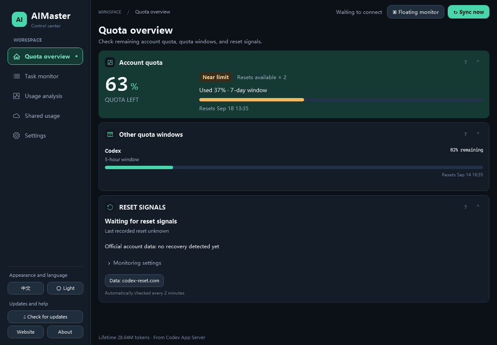
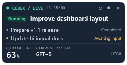
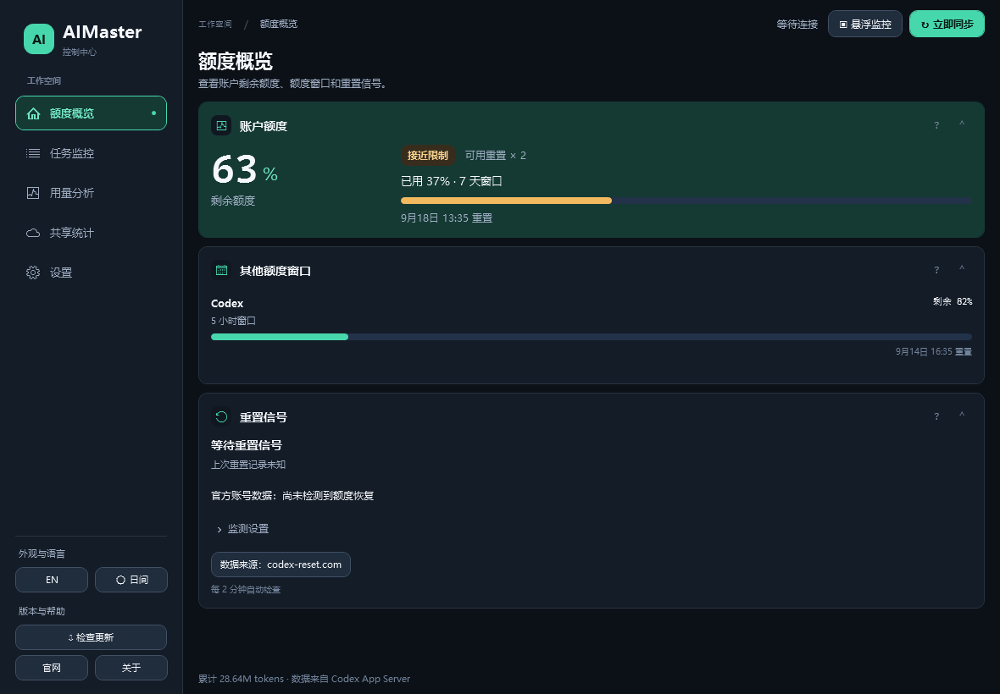

# AIMaster User Guide

[简体中文](USER-GUIDE.md) · **English**

## Main dashboard

The main window has five functional pages and opens on **Quota overview**:

| Page | Contents |
|---|---|
| Quota overview | Primary quota runway, quota windows, reset signals |
| Task monitor | Recent tasks, task guard, manual pause |
| Usage analysis | Local and project usage, today's hourly usage, weekly forecast |
| Shared usage | Device sync, clear and restore, group usage; displayed at full page width |
| Settings | Guard policy, daily warnings, floating text size, language, theme, updates, help |

The pages contain ten functional card types:

1. **Primary quota runway** shows remaining quota, usage, and the next reset.
2. **Task guard** shows protection status and can pause tasks visible to the current connection.
3. **Quota windows** lists the weekly and short windows returned by the account.
4. **Usage forecast** charts estimated and projected weekly quota remaining, plus the last seven days of usage. Switch between **Account** and **This device**: account mode includes every device using the account; local mode keeps the account's current remaining quota as its starting point but projects only this device's estimated rate, and changes the seven-day token chart to local records.
5. **Recent tasks** lists running, waiting, interrupted, paused, and completed tasks.
6. **Local usage** totals this device's weekly tokens, shows token-weighted top models for the device and each project, and estimates device/project quota attribution from the ratio of local tokens to same-period account tokens; when account history is incomplete, only local tokens are shown.
7. **Today / hourly usage** shows this device's tokens today, today's estimated share of the account's total weekly quota, and a local-token line chart for hours 00–23. The share is estimated from this week's account token history and weekly-window usage; it stays unavailable when the data is incomplete.
8. **Guard policy** configures warning and pause thresholds, automatic pausing, and floating-window text size.
9. **Shared usage** groups devices using the same sync key and shows each device's tokens, group share, top model, session count, and last sync time.
10. **Reset signals** monitors public reset previews and announcements, with source links and separate detection of official account quota recovery.

**Sync now** and **Floating monitor** remain at the top. Language, theme, update actions, the website and About stay at the bottom of the navigation rail on every page. Select **Sync now** to reconnect to Codex and refresh all data. Switching pages preserves unsaved form edits and keeps background monitoring running.

### Card layout

- The default layout is compact and follows actual content height. Old large heights no longer add blank space; new manual minimum-height adjustments are still saved.
- Use the left navigation to switch pages. Drag a card's top or side edges to reorder it within its page. Wide windows use two columns; narrow windows stack the panels. Shared usage adapts its connection form and device panel in the same way.
- Select the arrow in the upper-right corner to collapse or expand a card.
- Cards grow automatically to show their full content. Drag the bottom edge to adjust the minimum height; content cannot be compressed into clipping. Card width fills its column and follows the window size automatically.
- Long content scrolls with the whole page. Cards and the task list have no separate scroll view.
- Hover over the question mark in a card header for explanations and interaction tips. Drag areas have no visible icons.
- Double-click the bottom edge to restore its adaptive size.
- Card order, collapsed state, and custom height are saved automatically.

## Guard policy

- **Warning** changes the dashboard to a warning state when usage reaches the selected percentage.
- **Pause limit** activates the blocking state at the selected percentage.
- **Automatic pause** attempts to interrupt running tasks visible to the current App Server connection.
- **Quota warning notifications** is enabled by default. Uncheck it and select **Save & apply** to disable Windows notifications. The highest usage window triggers one warning and another when it reaches the pause limit. Further refreshes stay quiet until usage falls below the warning line. Notifications include the window, usage and reset time; clicking opens the dashboard. Monitoring continues in the tray after closing the main window. This switch is independent of automatic pause.
- **Floating font size** adjusts overlay text from 100% to 150%.
- **Daily account quota warning** is optional. Set 0.1–100% of the total weekly quota as the daily warning and select **Save & apply**. Today's account usage is estimated from token shares in the current Codex weekly cycle across all devices. Cycle boundaries within a day can introduce error; this is not an official daily quota bill. Missing history suppresses alerts.
- **Use recommendation** fills the average quota share of completed active calendar days in the current cycle plus 20%, rounded up to 0.1%. Today and the partial first cycle day are excluded. Save to apply it. During continuous monitoring, the same daily limit triggers once per local day; the notification switch controls delivery. Daily warnings do not pause tasks.

Live control is scoped to the App Server connection. Tasks running in another Codex window may need to be stopped in that window.

## Reset signals

Monitoring is enabled by default and reads public data from [codex-reset.com](https://codex-reset.com/) every two minutes. Both switches save immediately. Disable notifications to keep the card updating quietly, or disable monitoring to stop public API requests. Monitoring continues in the tray when the main window is hidden.

- The card shows active previews, recent announcements, check time and source fetch time. Bodies, tooltips and notifications follow the app language immediately; Chinese uses the source's translations, with a source prompt when no translation is available. **View source** opens the original announcement.
- The first fresh poll establishes the event baseline; subsequent new events notify once. On startup or reopening from the tray, a recorded account recovery or fresh confirmed reset announcement from today gets one catch-up notification if no reset notification was sent today. This uses the local calendar date and never replays yesterday's reset. Sent history persists separately across restarts. Both application switches must be enabled. A disabled Windows notification master switch does not consume the catch-up opportunity. A successful notification API request does not guarantee a displayed banner. Older versions have no sent history, so upgrading may produce one catch-up today.
- Stale data, request failures and alert-history storage failures pause signal notifications. Forecast probabilities, unconfirmed candidates and banked-reset grants are not global resets.
- Community reports do not confirm delivery to your account. Official quota period boundaries are checked separately: a confirmed new period triggers recovery without requiring high prior usage or current usage below 10%. Initial readings, periods that have not started, and percentage corrections alone do not establish recovery. The baseline and last recovery time persist locally, allowing the next check to detect a period that changed while the app was closed. Missed notifications from today follow the catch-up rule above.

No Codex credentials or session data are sent to the public feed. The source is an independent community tracker, unaffiliated with OpenAI, and cannot predict unpublished reset decisions. See the [API contract](https://codex-reset.com/developers).

## Multi-device shared usage

1. Select **Enable shared usage** on the first device.
2. Keep the server URL set to `https://www.woliux.com` and enter a recognizable device name.
3. Select **Generate key**, then **Save & sync**.
4. Select **Copy key** and paste the same key on your other devices. Give each device a distinct name.
5. Choose this device's **Reset policy**. Switching immediately saves it, recalculates usage and syncs, without another **Save & sync** click. The card shows each synced device's count under its own policy and its share of the group total.

- **Fixed weekly**: recalculate usage from this Monday at 00:00 in local time through now. Switching displays actual weekly usage, rather than starting at the switch time.
- **Clear on reset**: recalculate from the start of the current official weekly quota window through now. The start is the next official reset time minus the window duration; the first reading can already produce the count. Exact timestamps exclude usage before an intraday reset and include usage after the reset but before it was detected. Short windows and community previews do not define this period. If the official window is unavailable, or reset-day records lack timestamps, the card reports that accurate counting is unavailable and skips this device's upload instead of substituting zero or lifetime usage.
- **Never clear** (default): continue accumulating across weeks, initially including available local Codex session history.

The card displays this device's period start. Manual clear and undo records are separate for each policy and affect only this device's count under that policy. Switching policies does not clear usage or carry another policy's manual deductions into weekly or reset-period counts. **Restore** undoes the current policy's last manual clear and retains subsequent usage, within the selected time range. It is disabled afterwards or when that policy has no undo record. Session logs, other devices, dashboard local statistics, and account quota are unchanged.

Counts and undo history persist across restarts and updates. Deleting logs does not reduce already collected usage. Offline actions are saved locally and uploaded on the next successful sync. The server still groups device listings by calendar week, so each device must sync again to appear in the next week's list. Devices may select different policies; the group total sums their respective counts.

The sync key grants access to the shared usage group, so share it only between your own devices. AIMaster encrypts it locally with Windows DPAPI. Uploads contain only the device ID and name, weekly period, tokens, session count, top model, and capture time. Codex login tokens, task content, prompts, project names, and project paths are never uploaded.

Public sync requires HTTPS. The Woliu server stores only an HMAC-SHA256 group identifier derived with a server-side pepper, and retains data for 35 days by default.

## Floating monitor

Select **Floating monitor** in the main window. The overlay stays on top and displays:

- current status and task name;
- quota remaining;
- active model and reasoning effort;
- recent tasks according to the overlay height (up to eight).

Hover over a task to highlight it; click to open that task in the Codex desktop app. Moving or resizing the overlay saves its position and size for the next launch. If the monitor layout changes, it reopens within the visible work area.

The main window appears in the Windows taskbar; the floating monitor does not. Closing the main window hides AIMaster to the system tray while monitoring continues.

### System tray

- Click or double-click the AIMaster tray icon to restore the main window.
- Select **Show main window** to restore the dashboard.
- Select **AI floating monitor** to open or activate the overlay.
- Select **Exit** to close every window and stop the background process.

If the tray icon is not visible, expand the hidden-icons area in the Windows taskbar.

### Edge auto-hide

Drag the overlay to the top, left, or right edge of the current monitor. It collapses to an 8 px hover strip and pauses refreshing. Hover over the strip to expand and refresh immediately. Docking uses the work area of the monitor containing the overlay and works independently on secondary displays.

### Context menu

- **Refresh now** reads the latest state immediately.
- **Collapse now / Expand window** switches the docked state manually.
- **Auto-hide at edge** controls automatic collapsing near a screen edge.
- **Task name** chooses between the conversation title and the latest user request.
- **Refresh interval** offers 1, 2, 5, 10, or 30 seconds.

Conversation titles work well as stable identifiers. The latest-request mode is useful when following what a long-running task is currently doing. AIMaster falls back to the other available name if the selected source is missing.

## Language switching

Open **Settings**, then select `EN` or `中文` under **Appearance and language**. The dashboard, floating monitor, tray menu, status text, and reset times switch immediately, and the choice is saved locally.

## Status reference

| Status | Meaning |
|---|---|
| Running | The task is still executing or its latest local session has no completion marker. |
| Waiting for approval/input | The task requires action before it can continue. |
| Interrupted/paused | The task was interrupted, cancelled, or paused. |
| Completed | The task finished normally. |
| Offline | App Server is unavailable. Quota may not update, but local task records are still used when possible. |

## Settings and migration

Settings are stored in `%LOCALAPPDATA%\AIMaster\settings.json`.

If `%LOCALAPPDATA%\SoftwareToolkit\ai-manager.json` exists and no AIMaster settings file has been created yet, it is copied automatically on first launch.
