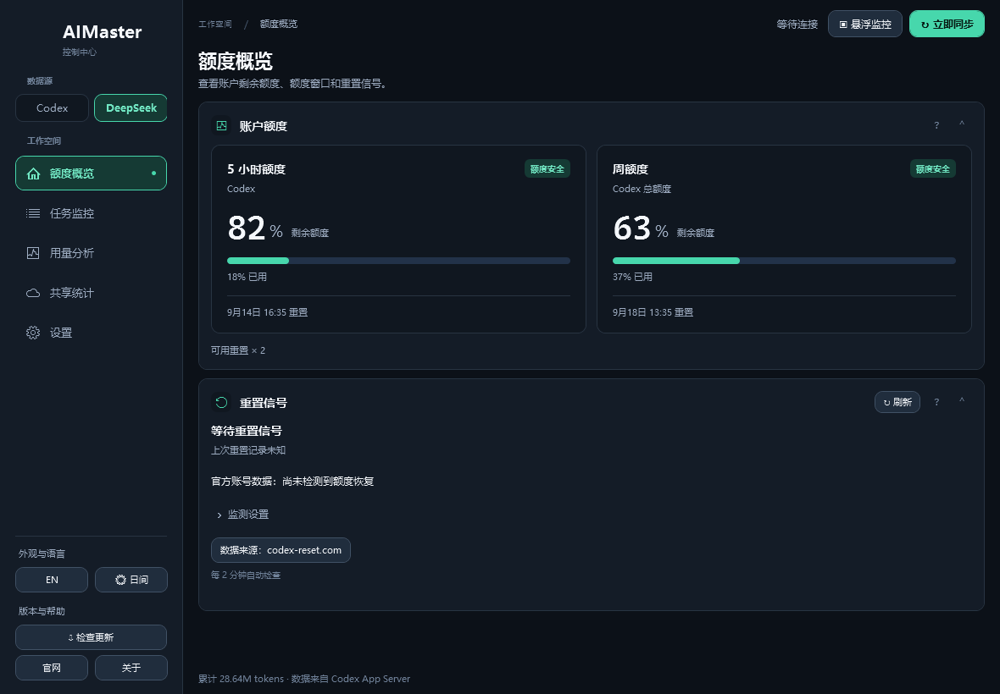
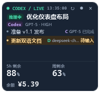
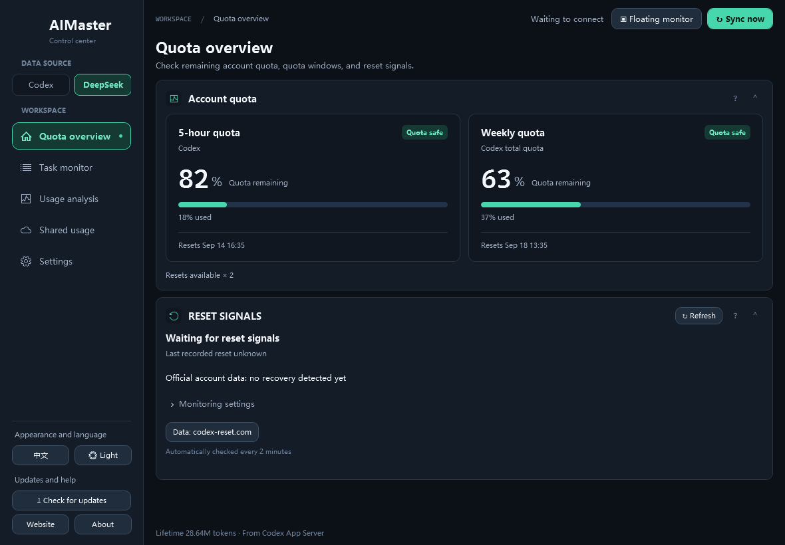

# AIMaster 用户手册

**简体中文** · [English](USER-GUIDE.en.md)

## 主面板

主窗口通过左侧导航切换五个页面，默认打开“额度概览”。右侧显示页面标题和独立的内容分区：

| 页面 | 内容 |
|---|---|
| 额度概览 | 额度跑道、额度窗口、重置信号 |
| 任务监控 | 最近任务、任务闸门与手动暂停 |
| 用量分析 | 本机与项目消耗、当日时段用量、本周预测 |
| 共享统计 | 设备同步配置、清零与恢复、同组设备用量；使用整页宽度 |
| 设置 | 保护策略、每日预警、DeepSeek 接入、浮窗字号、语言、主题、更新与帮助 |

各页面中的十一类功能卡片如下（Codex 与 DeepSeek 共用额度、任务、用量和设置卡片，其余卡片按数据源显示）：

1. **额度跑道**：展示剩余比例、已使用比例和最近重置时间。
2. **任务闸门**：显示保护状态，并允许手动暂停当前连接能够控制的任务。
3. **额度窗口**：列出账户返回的周窗口、短窗口及各自重置时间。
4. **消耗预测**：用折线图展示本周剩余额度估算和未来预测，并汇总近 7 日用量。可切换“账号 / 本机”：账号模式汇总同一账号所有设备；本机模式仍以账号当前剩余额度为起点，但仅按当前设备的估算消耗速度推演，近 7 日 Token 也切换为本机记录。
5. **最近任务**：显示进行中、等待输入、已中断/暂停和已完成的任务。
6. **本机消耗**：汇总本周本机 Token，并按 Token 用量显示本机及各项目的常用模型；同时用“本机 Token ÷ 账号同周期 Token”估算当前设备及各项目的周额度占比，账号历史不完整时只显示本机 Token。
7. **当日消耗 / 时段**：显示今天的本机 Token、今日消耗约占账号周总额度的比例，以及 0–23 时每小时的本机 Token 折线图。周总额度占比由账号本周 Token 历史与周窗口已用比例估算；数据不足时不生成占比。
8. **保护策略**：设置预警线、暂停线、自动暂停、通知栏提示和浮窗字号。
9. **共享统计**：将使用相同同步密钥的设备归为一组，展示每台设备的 Token、组内占比、常用模型、会话数和最后同步时间。
10. **重置信号**：自动监测公开的重置预告与公告，提供原文入口，并单独检测官方账号额度恢复。
11. **DeepSeek 接入**：配置 DeepSeek API Key、可选的平台 Token 和余额预警线；设置加密保存在本机。

顶部保留“立即同步”和“悬浮监控”。语言、主题、检查更新、更新说明、官网和关于入口常驻左侧栏底部，所有页面都可使用。点击“立即同步”会重新连接当前数据源并刷新全部数据；切换页面不会丢失尚未保存的表单内容，也不会停止后台监控。

### 数据源切换

左侧栏顶部的“数据源”提供 Codex 与 DeepSeek 两个按钮，选择后立即保存并刷新：

- **Codex**：读取 Codex 额度、在线任务和本地会话记录，界面与旧版本一致。
- **DeepSeek**：读取 DeepSeek 账户余额和可选用量明细，任务来自 Deep Code 的本地会话索引。
- 两种模式共用主窗口、悬浮窗、主题、语言和刷新频率；任务列表统一显示 Codex 与 Deep Code 的任务，并标注每条任务的来源和所用模型，切换数据源不会隐藏另一侧的任务历史。
- Codex 专属的任务闸门、消耗预测、重置信号、共享统计和百分比阈值在 DeepSeek 模式下隐藏；DeepSeek 没有官方百分比额度窗口。

### 开机自启

在“设置”页开启“开机自动启动 AIMaster”，下次登录当前 Windows 账号时将自动打开程序，主窗口和浮窗沿用现有启动行为。默认关闭，切换后立即生效，无需点击“保存并应用”，也无需管理员权限。取消勾选即可移除启动项。

启动项使用开启时的程序路径；移动或重新解压程序后，请在新位置关闭再开启一次。原地更新不影响启动项。若在 Windows 的“启动应用”中禁用了 AIMaster，还需在那里重新启用。

### 卡片布局

- 默认使用紧凑排版，按实际内容决定高度；旧版大高度设置不再增加留白，重新手动调整的最小高度仍会保存。
- 鼠标移到卡片上边缘或两侧后，按住拖动可在当前功能页内调整顺序或移动到另一列。宽窗口使用双列，窄窗口自动上下排列；共享统计的连接表单和设备面板也随宽度调整。
- 点击右上角箭头可折叠或展开卡片。
- 卡片根据内容自动撑高；拖动下边缘可调整最小高度，不能将内容压缩到被裁切。卡片宽度自动铺满所在列并随窗口缩放。
- 悬停卡片右上角的“?”可查看说明和操作提示；拖动区域不显示图标。
- 双击卡片下边缘可恢复自适应尺寸。
- 内容较多时统一滚动整个页面，卡片和任务列表不使用独立滚动视图。
- 卡片顺序、折叠状态和自定义高度均会自动保存。

## DeepSeek 数据源

### 配置

在“设置 → DeepSeek 接入”中填写：

- **API Key**：用于读取 DeepSeek 官方 `https://api.deepseek.com/user/balance` 余额。必填。
- **平台 Token**：可选。填写后可读取 `platform.deepseek.com` 的今日与近 30 天消耗、Token、请求数和按模型花费。该接口是平台网页使用的私有接口，不是公开文档 API，可能随平台改版失效；失效时余额仍然显示，卡片会提示用量明细不可用。
- **余额预警线**：账户余额低于该金额时，额度卡显示“余额偏低”并使用警示色；填 0 关闭。
- 两种凭证使用 Windows DPAPI 加密后保存在本机 `settings.json`，不上传、不写入日志，也不进入共享统计。点击“保存 DeepSeek 配置”后立即生效；若当前正在查看 DeepSeek，会立刻重新同步。
- 平台 Token 可从浏览器已登录的 DeepSeek 平台会话中获取；它和 API Key 相互独立，更新其中一个不影响另一个。

### 余额与用量

- 额度卡以大号金额显示总余额，并列出付费/赠送构成。余额为 0 或接口返回不可用时显示“余额不足”。
- 主卡片下方显示今日花费与 Token，以及近 30 天（或本月，取决于平台接口回退）的花费和 Token。
- “当日消耗 / 时段”卡显示 DeepSeek 平台返回的当日 Token 与花费；DeepSeek 不提供分时用量，因此不绘制每小时折线图。
- “本机消耗”卡汇总 Deep Code 本地会话的 Token，并按项目显示占比和常用模型。Deep Code 的用量按会话最后更新时间归属到当天，不是逐条消息账单。
- DeepSeek 没有 5 小时/7 天百分比窗口，因此不显示额度百分比、消耗预测或任务闸门，也不会触发 Codex 的额度通知。

### Deep Code 任务

- 任务列表读取 `%USERPROFILE%\.deepcode\projects\*\sessions-index.json`，只读本地索引，不会启动 Deep Code。
- 显示会话摘要、运行状态（运行中、等待批准、等待输入、已完成、已暂停、异常）、模型、推理强度和更新时间。
- 模型优先取会话的 `usagePerModel`，缺失时回退到 `~/.deepcode/settings.json` 的 `env.MODEL`；推理强度取该文件的 `reasoningEffort`。
- 主窗口和悬浮窗的任务列表把 Codex 与 Deep Code 的任务合并显示，每条任务都标注来源和模型；主窗口任务列表只展示状态，悬浮窗中点击 Deep Code 任务会在资源管理器中打开对应项目目录。
- 首次使用 DeepSeek 数据源且本机没有 Deep Code 会话时，列表里只剩 Codex 任务是正常现象。

## 保护策略

- **预警线**：使用量达到该比例时显示预警。
- **暂停线**：使用量达到该比例时显示阻断提示。
- **自动暂停**：启用后，AIMaster 会尝试中断当前 App Server 连接可见的进行中任务。
- **额度预警通知栏提示**：默认开启，可取消勾选后点击“保存并应用”关闭。最高额度窗口达到预警线时发送 Windows 通知，达到暂停线时再提醒一次；持续超线时不会重复弹出，回落到预警线以下后恢复提醒。提示包含窗口、已用比例和重置时间，点击可打开主面板。关闭主窗口后仍在后台监控，通知开关独立于自动暂停。
- **每日账号额度预警**：单独勾选启用，以周总额度的百分比设置每日预警线（0.1–100%），再点击“保存并应用”。今日消耗按账号本周期的 Token 比例与 Codex 周额度占用估算，包含所有设备，周期边界跨日时可能存在偏差；不是官方每日额度账单。数据缺失时不触发提醒。
- **使用推荐值**：取本周期已结束且有消耗的完整自然日，按日均额度占比加 20% 余量，向上取整到 0.1%；当天及周期开始的非完整日期不参与推荐。点击后仅填入设置，仍需“保存并应用”。每日预警仅提醒，持续运行时每天同一限额提醒一次，受通知栏开关控制，不自动暂停任务。

Codex 的实时控制范围与 App Server 连接有关。其他 Codex 窗口中的任务不一定能被当前 AIMaster 实例直接中断，请在相应 Codex 窗口中确认任务状态。

## 重置信号

“重置信号”卡片默认开启监测，每 2 分钟读取 [codex-reset.com](https://codex-reset.com/) 的公开数据。两个开关立即保存：可单独关闭通知，也可关闭监测以停止公开接口请求。关闭主窗口后仍通过托盘在后台监测。

- 显示有效预告、最近公告、检查时间和来源抓取时间。正文、提示和通知跟随应用语言即时切换；中文使用数据源提供的译文，暂无译文时提示查看原文。“查看原文”打开对应公告。
- 重置提醒使用正式 Windows 应用通知，横幅消失后仍保留在通知中心，默认一天后到期；点击通知打开 AIMaster。启动或退出应用不会清空通知历史。便携版会在当前用户开始菜单中建立 AIMaster 入口，关联通知身份与点击激活。启动应用或从托盘重新打开时，若当天已有账号恢复记录、有效预告/信号或重置公告，且当天尚未确认进入通知中心，补发一次；按本地日期判断，不补发昨天的事件。应用的监测和通知开关仍需开启；被系统关闭或投递失败时保留补发机会。卡片底部区分投递请求与通知中心留存确认。旧版临时气泡的显示回执不算留存成功，升级当天可能补发一次。需要 Windows 10 1809 或更新版本。
- 过期数据、接口异常和无法保存提醒记录时暂停信号通知。概率预测、未确认候选和储备重置发放不视为全局重置。
- 社区转述不代表账号额度已到账。“官方账号数据”单独检查 Codex 返回的额度周期边界；确认已跨入新的官方周期后提示额度恢复，不要求之前用量很高或当前用量低于 10%。首次读取、尚未开始的周期和单纯百分比修正不触发恢复检测。检测基线及最近恢复时间保存在本机，关闭期间跨周期也可在下次检查时识别；当天漏发的通知按上述规则补发。

公开接口不接收 Codex 凭证或本地会话数据。来源为独立社区追踪器，与 OpenAI 无隶属关系；无法预知尚未公开的临时重置决定。接口约定见 [API 文档](https://codex-reset.com/developers)。

## 多设备共享统计

1. 在第一台设备的“共享统计”卡片中勾选“启用共享统计”。
2. 保持服务器地址为 `https://www.woliux.com`，填写容易识别的设备名称。
3. 点击“生成密钥”，再点击“保存并同步”。
4. 点击“复制密钥”，把同一密钥粘贴到其他设备；每台设备应填写不同的设备名称。
5. 选择当前设备的“清零方式”，切换后立即保存并重新计算、同步共享用量，无需再点击“保存并同步”。其他设备同步后，卡片显示各设备按其所选方式计算的用量与组内占比。

- **固定每周**：重新计算本机时间的本周一 00:00 至现在的用量。切换到该方式会显示本周实际用量，不以切换时间为起点。
- **重置时清零**：重新计算当前官方周额度窗口开始至现在的用量。起点由官方返回的下次重置时间减去周窗口时长确定，首次读取即可统计；记录按精确时间戳筛选，同一天重置前的记录不计入，重置后、检测前的消耗会计入。短时窗口和社区预告不作为周统计起点。无法取得有效窗口，或重置当天的记录缺少时间戳时，提示无法准确统计，并暂停该设备的共享上传，不上传零值或累计量冒充本周期。
- **不清零**（默认）：跨周持续累计，初次启用包括本机现有可读取的 Codex 会话历史。

卡片显示当前设备的统计起点。“手动清零”和“恢复”记录按清零方式独立保存，仅影响当前设备在当前方式下的计数；切换方式不会执行清零，也不会把其他方式的手动清零扣减带入本周或重置周期。“恢复”撤销当前方式最近一次手动清零，并保留之后新增用量，仍按所选时间范围统计。恢复后该按钮变为不可用；没有当前方式的恢复记录时也不可用。操作不删除会话日志，不修改其他设备或主面板的本机统计、账号额度。

本机计数和恢复记录持久化保存，重启或更新后继续使用；已采集的用量不会因日志删除而减少。离线清零/恢复先保存本机结果，下次成功同步更新当前设备。服务端仍按当前日历周组织设备列表，因此每台设备跨周后需重新同步才能出现在新周列表中；各设备可选择不同方式，组内总计是这些设备计数的合计。

同步密钥是共享统计组的访问凭证，请只在自己的设备间传递。AIMaster 使用 Windows DPAPI 加密后保存密钥。上传数据仅包含设备 ID、设备名称、周统计周期、Token、会话数、常用模型和采集时间，不包含 Codex 登录令牌、任务内容、提示词、项目名称或项目路径。

公网同步强制使用 HTTPS。涡流网服务端只保存同步密钥经过服务器侧 HMAC-SHA256 生成的组标识，数据默认保留 35 天。

## 悬浮监控

点击“悬浮监控”打开桌面浮窗。浮窗默认置顶并显示：

- 顶部标出当前数据源，右侧是最近一次额度采集时间；
- 最近任务统一列出 Codex 与 Deep Code 的任务，每条任务标注来源（Codex/DeepSeek）和所用模型，主要任务的模型与推理强度显示在标题下方；
- Codex 的 5 小时和周剩余额度，以及 DeepSeek 余额，同时显示在浮窗底部；额度区始终贴住浮窗底边，浮窗拉高后多出的空间留给任务列表；
- 根据浮窗高度显示最近任务（最多 8 个）。

右键菜单的“额度显示”可在“全部额度”（默认，Codex 额度与 DeepSeek 余额同时显示）和“仅当前数据源”（只显示当前选中数据源的额度）之间切换，选择会保存到本机。

鼠标悬停在浮窗任务行上时，该行会高亮；单击 Codex 任务会在 Codex 桌面端打开对应任务，单击 Deep Code 任务会在资源管理器中打开其项目目录。没有可用目标的任务行不可点击。

拖动或调整浮窗大小后，位置和尺寸会保存在本机设置中。重新打开程序或使用新打包版本时会恢复；显示器变化时会调整到可见区域。

主窗口显示在 Windows 任务栏，悬浮窗不占用任务栏位置。关闭主窗口后，AIMaster 会隐藏到系统托盘并继续后台刷新与执行额度保护；单击托盘图标即可恢复主窗口。

### 系统托盘

- 单击或双击 AIMaster 托盘图标：恢复并激活主窗口。
- 右键选择“显示主窗口”：恢复主面板。
- 右键选择“AI 悬浮监控”：打开或激活浮窗。
- 右键选择“退出”：关闭所有窗口并真正结束后台进程。

如果托盘图标没有直接显示，请展开 Windows 任务栏右侧的隐藏图标区域。

### 靠边收起

把浮窗拖到当前显示器的上、左或右边缘即可收起。收起后仅保留 8 px 感应条，减少遮挡并停止刷新。鼠标悬停会展开并立即更新数据。该功能使用浮窗所在显示器的工作区，因此主屏和副屏均可独立靠边收起。

### 右键菜单

- **立即刷新**：不等待计时器，马上读取一次状态。
- **立即收起/展开**：手动切换靠边状态。
- **靠边自动收起**：决定拖到边缘时是否自动收起。
- **任务名称显示**：可在“对话标题”和“最后发送内容”之间切换，选择后立即刷新并永久保存。
- **额度显示**：可选“全部额度”（默认）或“仅当前数据源”；前者同时显示 Codex 的 5 小时/周额度与 DeepSeek 余额。
- **刷新频率**：可选 1、2、5、10 或 30 秒。

“对话标题”适合稳定识别一个长期任务；“最后发送内容”适合观察该任务当前正在处理的具体要求。若某项来源暂时不可用，AIMaster 会自动回退到另一项可用名称。

## 中英文切换

打开“设置”页，在“外观与语言”中点击 `EN` 或 `中文` 即可即时切换界面语言，选择会保存到本地设置。主面板、悬浮窗、托盘菜单、状态文字和重置时间会同步切换。

## 状态说明

| 状态 | 含义 |
|---|---|
| 进行中 | 任务仍在执行或最近会话没有结束标记 |
| 等待批准 | Codex 命令/文件变更审批或 Deep Code 权限请求尚未答复 |
| 等待输入 | 任务正在等待用户补充输入 |
| 等待开始 | Deep Code 会话已创建但尚未开始处理 |
| 已中断/暂停 | 任务被中断、取消或暂停 |
| 已完成 | 任务已经正常结束 |
| 异常 | 任务失败、权限被拒绝或连接异常 |
| 离线 | App Server 不可用，额度可能无法更新；任务仍会尝试从本地记录读取 |

## 设置与迁移

设置文件：`%LOCALAPPDATA%\AIMaster\settings.json`

如果旧版配置 `%LOCALAPPDATA%\SoftwareToolkit\ai-manager.json` 存在，而新配置尚未建立，AIMaster 会在第一次启动时自动复制旧设置。
